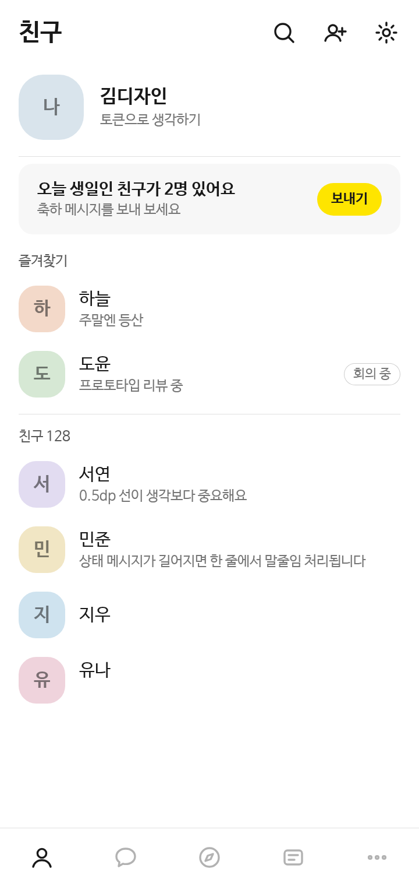
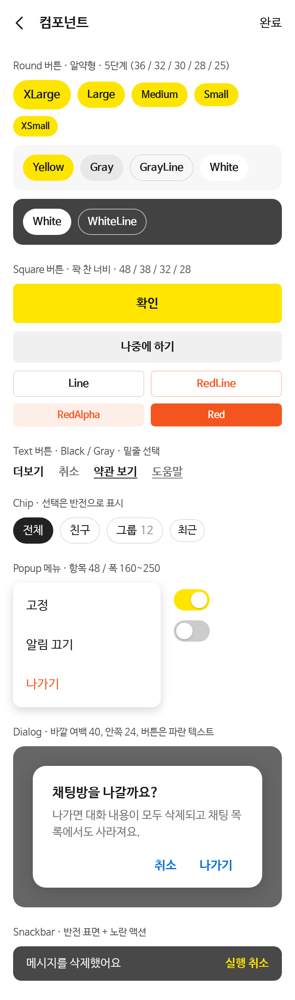

# KakaoTalk Design 참고 스킬

> 카카오톡 Android 앱(25.7.3)의 공개 배포본 리소스를 관찰해서, 색상·간격·글자·컴포넌트 규칙을 **원칙 중심으로 정리한 비공식 스킬 팩**입니다.
>
> 카카오와 관련이 없는 개인 학습 자료이며, 카카오의 공식 디자인 가이드가 아닙니다.

## 무엇이 들어 있나

| 경로 | 내용 |
|---|---|
| `SKILL.md` | Claude Code 등에서 바로 쓰는 스킬. 핵심 원칙 12개, 작업 순서, 빠른 참조표, 리뷰 체크리스트 |
| `sources/kakaotalk-design-observations.md` | 관찰한 수치 전체 (Day/Night 색상, 타이포, 간격, 버튼·칩·채팅·다이얼로그) |
| `examples/tokens.css` | 관찰한 색상 토큰을 CSS 변수로 다시 적은 것 (Day / Night) |
| `examples/*.html` | 토큰만으로 다시 만든 예시 화면 |
| `img/` | 예시 화면 스크린샷 |

## 예시 화면

아래 화면은 이 저장소의 `examples/tokens.css`와 `examples/base.css`만으로 **새로 만든 재현 화면**입니다. 앱 스크린샷이 아니며, 카카오의 로고·아이콘·이미지·폰트를 쓰지 않았습니다. 인물과 대화는 모두 가상입니다.

| 친구 목록 | 채팅방 (Day) | 채팅방 (Night) |
|---|---|---|
|  |  |  |

<details>
<summary>컴포넌트 시트 (버튼, 칩, 팝업, 다이얼로그, 스낵바)</summary>



</details>

## 핵심 원칙 요약

1. 색은 원색 이름이 아니라 **역할 이름**(title, description, cell-border)으로 부른다.
2. 팔레트는 **명도 숫자 + s(불투명) / a(투명)** 규칙으로 만든다.
3. 다크 모드는 **이름은 그대로, 값만 바꾼다.**
4. 다크에서는 그림자 대신 **명도로 높이**를 표현한다.
5. 본문은 #191919, 다크 배경은 #080808. **순수 검정은 피한다.**
6. 구분선·눌림·회색 면은 **alpha 오버레이**로 만들어 어떤 배경에서도 어울리게 한다.
7. 브랜드 색은 하나, **모드와 상관없이 고정**하고 그 위 글자는 항상 진한 색.
8. 강조색은 면에만. 링크·다이얼로그 버튼은 파랑, **선택은 반전**으로 표시.
9. **알약형 Round = 보조 행동, 꽉 찬 Square = 화면의 결론.**
10. 위계는 굵기보다 **크기와 회색 단계**로.
11. 선은 **0.5dp**로 얇게.
12. 모든 컴포넌트에 **Day/Night 고정 탈출구**를 둔다.

자세한 수치는 [`sources/kakaotalk-design-observations.md`](sources/kakaotalk-design-observations.md)에 있습니다.

## 설치

### Claude Code

```bash
mkdir -p ~/.claude/skills && git clone https://github.com/wintermute08/KakaoTalk-Design-Skill ~/.claude/skills/kakaotalk-design
```

### OpenCode

```bash
mkdir -p ~/.config/opencode/skills && git clone https://github.com/wintermute08/KakaoTalk-Design-Skill ~/.config/opencode/skills/kakaotalk-design
```

### skills CLI

```bash
npx skills add wintermute08/KakaoTalk-Design-Skill
```

설치한 뒤 "카카오톡 디자인 원칙으로 설정 화면 만들어줘"처럼 요청하면 됩니다.

## 예시 화면 다시 찍기

```bash
chrome-headless-shell --no-sandbox --hide-scrollbars --force-device-scale-factor=2 \
  --window-size=360,760 --screenshot=img/friends.png "file://$PWD/examples/friends.html"
```

## 어떻게 만들었나

- 공개 배포된 앱 패키지의 컴파일된 리소스(`res/values*`)를 `apktool`로 디코딩해 수치를 읽었습니다.
- 코드에만 있는 버튼 크기는 버튼 위젯 두 개에서 숫자만 확인했습니다.
- 리소스 파일, 이미지, 아이콘, 폰트, 코드는 **저장소에 넣지 않았습니다.** 관찰한 값을 표와 원칙으로 다시 썼습니다.

## 주의

- 이 저장소는 카카오(Kakao Corp.)와 관련이 없습니다. "카카오톡", "KakaoTalk"과 관련 상표는 카카오의 것입니다.
- 앱 버전이 바뀌면 수치도 바뀔 수 있습니다. 이 문서는 25.7.3 기준입니다.
- 카카오 서비스로 오인될 수 있는 화면(로그인, 결제, 인증, 공지 등)을 만드는 데 쓰지 마세요. 원칙을 참고해 **자기 제품의 디자인**을 만드는 용도로 써 주세요.
- 문제가 되는 내용이 있으면 이슈로 알려 주세요. 바로 고치거나 내리겠습니다.

## License

문서와 예시 코드는 MIT License입니다. 상표와 원 저작물의 권리는 각 권리자에게 있습니다.
